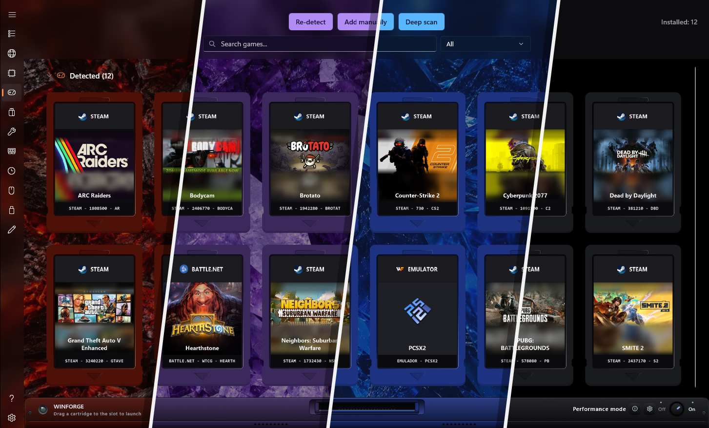
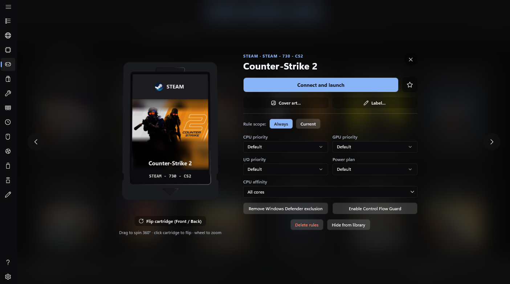
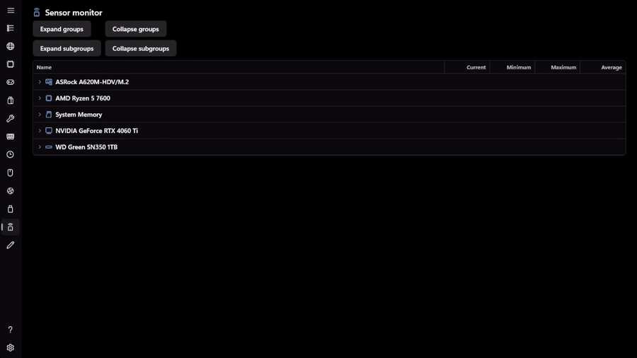

  

<h1 align="center">WinForge</h1>

  <b>The competitive optimizer for Windows.</b> 
  Monitor your PC, tune it while you play, manage your games and shape Windows around the way
  you actually use it — all from one app, built for gamers and power users.

  <b>100% free</b> — every optimization feature is completely free, with no limits.

  
   
  30/10/2026 - UTC-3
   
   
  
  &nbsp;
  
  &nbsp;
  
   
  ⭐ Beta — found a problem? <a href="https://github.com/Maximiliano-Fallini/WinForge/issues">Open an issue</a>

  
   
  <b>One library, any look.</b> The 3D cartridge library and console dock in four of the built-in themes.

## 📸 A closer look

  
   
  <b>Per-game rules.</b> CPU and GPU priority, I/O priority, power plan, core affinity, Windows Defender exclusion and Control Flow Guard — set from one panel.

  
   
  <b>Sensor monitor.</b> Live readings for every component, grouped by device and expandable by category.

## ✨ What it does

WinForge brings together what is usually spread across half a dozen tools: live monitoring,
in-game optimization, game management and Windows tuning.

| Area | What it includes |
|---|---|
| 🎮 **Game Mode** | Optimizes automatically when a game starts (processes, services, power plan) and reverts everything when it closes. |
| 🕹️ **Game library** | Detects games from Steam, Epic, GOG, Xbox and other launchers — plus emulators — with per-game rules (priority, affinity, power plan). Includes a 3D cartridge mode with a console dock and an inspection view. |
| 📊 **Monitoring** | CPU, memory, network, temperatures and an in-game metrics overlay with keyboard shortcuts. |
| ⚡ **Cores and power** | Power plans, turbo ceiling (boost and performance limit) with Default and Recommended profiles, affinity and per-core monitoring. |
| 🧠 **Optimizations** | The Windows tuning hub, Winhance-style: 418 tweaks across 10 categories (privacy, power, gaming, updates, notifications, sound, Explorer, startup, taskbar and theme), with a recommended profile and ready-made presets. The same hub hosts advanced TCP/Network, Debloat, Tools and features, Windows panel, Repair, Windows Update, Device cleanup and Startup management. |
| 🧰 **Tools** | Macros, autoclicker, cache and registry cleanup, power plans, DNS, system repair and more. |
| 🧩 **Workshop** | The catalog of everything WinForge can do: the core sections that ship with the app plus the components you install, update or remove from there. |

## 🧩 Installable components

Beyond the core sections, these components live in the Workshop and can be installed, updated or
removed from the app itself. They are listed with what each one does.

| Component | Availability | What it does |
|---|---|---|
| **Timer resolution** | Installable | Latency tuning: enables the Windows GlobalTimerResolutionRequest rule to cut input lag. |
| **USB overclocking** | Installable | Raises the polling rate of USB devices to cut input lag. |
| **Key filter** | Installable | Keyboard repeat delay in milliseconds and key filtering (FilterKeys). |
| **Memory** | Installable | Smart automatic cleanup of the RAM cache. |
| **Sensor monitor** | Installable | Live sensors: temperatures, voltages and clocks, grouped and expandable. CPU temperature, clock and power need the PawnIO driver; while it is missing, the page shows a notice with a direct link to Settings → Drivers and keeps showing the readings that do not need it. |
| **Fans** | Installable | PWM curves per channel with a selectable temperature sensor classified by role (CPU, GPU, VRM, board) and its live reading in the selector, or the hottest of CPU and GPU, through the PawnIO driver, with autostart on sign-in. |
| **Process management** | Installable | System process manager, with resource usage, priorities and states. |
| **Stability test** | Installable | Stress tests to validate that the machine holds up. |
| **Metrics overlay** | Installable · in development | On-screen metrics: FPS, CPU, GPU, RAM, 1% low and more. |
| **Macros** | Installable | Record key and click sequences and replay them with a global hotkey. |
| **Autoclicker** | Installable | Configurable automatic clicks with a global hotkey. |
| **3D scene benchmark** | Downloadable · in development | Its own 3D scenes to measure the GPU and the whole machine, with live metrics and a comparable report (no score). |

PawnIO (sensor monitor and fans) and hidusbf (USB overclocking) are shared dependencies, so they do not belong to any component: **Settings → Drivers** is the permanent place to see, install, repair or uninstall them even if the components that use them are removed. The sensor monitor and USB overclocking link there when the driver is missing; the fans page also offers the one-click install itself.

## 🌐 Multilanguage

  <b>20 languages</b>, shipped with the app or installed as language packs.

  &nbsp;&nbsp;
  &nbsp;&nbsp;
  &nbsp;&nbsp;
  &nbsp;&nbsp;
  &nbsp;&nbsp;
  &nbsp;&nbsp;
  
   
  &nbsp;&nbsp;
  &nbsp;&nbsp;
  &nbsp;&nbsp;
  &nbsp;&nbsp;
  &nbsp;&nbsp;
  &nbsp;&nbsp;
  
   
  &nbsp;&nbsp;
  &nbsp;&nbsp;
  &nbsp;&nbsp;
  &nbsp;&nbsp;
  &nbsp;&nbsp;
  

## ⚙️ Requirements

- **Windows 10/11 x64** (tested on Windows 11 25H2).
- **Administrator permissions**: the app elevates on launch because it modifies the system.

## 📦 Installation

The installer is self-contained (no .NET or Windows App SDK needed) and the app updates itself
from **Settings → Updates**. Every release is built in CI (GitHub Actions) from the code in this
repository.

**Code signing policy** · [Code signing policy](CODE_SIGNING.md) — what is signed, how the
installer is built and how to verify a download.

## ⭐ Support the project

<b>Every optimization feature is 100% free.</b> 
If you like WinForge, leave a ⭐ to show your support — it is free and it helps the project keep growing.

> [!WARNING]
> This application is **not digitally signed** and, by design, **modifies the operating system
> while running as administrator** (file cleanup, process management, system tweaks, and so on).
> For those reasons, some antivirus engines may flag it as a **false positive**.
>
> If you trust the project, add an exclusion in your antivirus. You can verify the integrity of
> the installer by comparing the SHA-256 published with each release.

## 🙌 Built on and inspired by

WinForge does not reinvent the wheel: every feature started by studying (and sometimes trying to
improve on) tools that already existed. These are the projects it is built on and inspired by,
from the best known to the least known:

| Project | Contribution that inspired it |
|---|---|
| **[CCleaner](https://www.ccleaner.com/ccleaner)** | Cache, temporary files and registry cleanup, with a backup before touching anything |
| **[MSI Afterburner](https://www.msi.com/Landing/afterburner/graphics-cards)** | In-game metrics overlay and live monitoring |
| **[Process Lasso](https://bitsum.com/processlasso/)** | Priority, core affinity and efficiency mode per process |
| **[FanControl](https://getfancontrol.com/)** | Fan curves per sensor |
| **[DNS Jumper](https://www.sordum.org/7952/dns-jumper-v2-3/)** | One-click DNS switching |
| **[Quick CPU](https://coderbag.com/product/quickcpu)** | Power plan and core control |
| **[WinUtil](https://github.com/ChrisTitusTech/winutil)** | Debloat and Windows tweaks in one place |
| **[Winhance](https://github.com/memstechtips/Winhance)** | Windows settings hub with a recommended profile and ready-made presets |
| **[TCP Optimizer](https://www.speedguide.net/downloads.php)** | Network and adapter property tweaks |
| **[ISLC](https://www.wagnardsoft.com/intelligent-standby-list-cleaner-islc)** | Standby memory list cleanup |
| **[MacroGamer](https://www.macrogamer.com/)** | Keyboard and mouse macros with a global hotkey |
| **[FilterKeys Setter](https://github.com/HQJaTu/Filterkeys-setter)** | Keyboard repeat delay in milliseconds, beyond the Control Panel |
| **[hidusbf](https://github.com/LordOfMice/hidusbf)** | Polling rate for mice, keyboards and controllers through a kernel filter |
| **[Carthage](https://github.com/lopiksaa/carthage)** | Game library with 3D cartridges, a bottom console and printed labels |

WinForge is not affiliated with any of them: they are references that marked the way, and every
trademark belongs to its authors.

---

*WinForge — the competitive optimizer for your Windows. Maximum performance, maximum control.*
